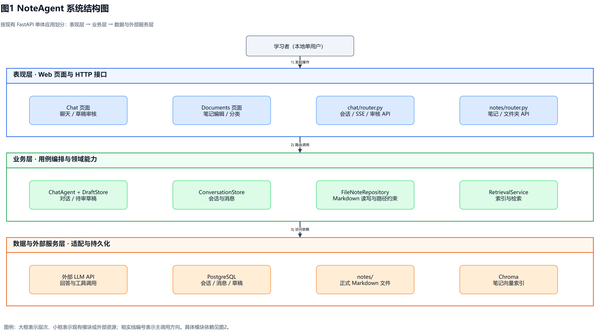
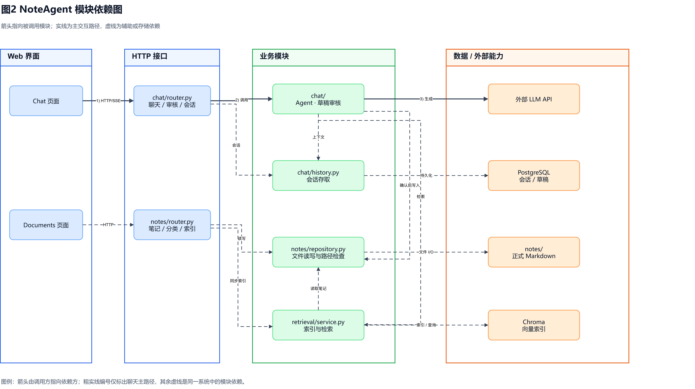

# 实验四：NoteAgent 系统概要设计

## 1. 设计依据与范围

本设计以[实验二需求规格说明书](experiment-02-srs.md)中的 FR-01～FR-08、NFR-01～NFR-06 为依据，并核对当前 `src/noteagent/` 的实现。NoteAgent 是个人学习笔记系统，主要功能是聊天、待审笔记草稿、Markdown 笔记管理和检索。实验要求中的“用户、图书、借阅、统计模块”是示例，不能直接套用于本项目；当前课程范围不设计多用户账号和管理员后台。

概要设计描述模块职责、调用方向和接口边界。具体数据库表、类内部算法与页面控件细节留待详细设计；本节也不把需求中尚待完善的行为写成已完成的代码功能。

## 2. 系统架构

采用与当前 FastAPI 单体应用一致的三层架构。表现层接收用户操作并转换为 HTTP/SSE 请求；业务层完成对话、人工审核、文件管理与检索编排；数据与外部服务层提供会话持久化、Markdown 文件、向量索引和大模型能力。这是**逻辑分层**，不是三个独立部署的服务。

| 层次 | 主要组成 | 职责 | 边界 |
| --- | --- | --- | --- |
| 表现层 | Chat、Documents 页面；`chat/router.py`、`notes/router.py` | 展示信息、校验请求、调用业务能力、返回 JSON 或 SSE | 页面不直接操作数据库、Markdown 或 Chroma；路由不直接生成模型回答 |
| 业务层 | `ChatAgent`、`DraftStore`、`ConversationStore`、`FileNoteRepository`、`RetrievalService` | 对话编排、草稿审核、会话存取、笔记路径与文件操作、索引和检索 | 大模型只能提出草稿；正式笔记的写入须经人工确认或 Documents 显式操作 |
| 数据与外部服务层 | PostgreSQL、`notes/`、Chroma、外部 LLM API | 保存会话/消息/草稿、保存正式笔记、保存可重建索引、提供模型推理 | Markdown 是笔记事实来源；Chroma 是派生索引，不能代替正式笔记 |

[图 1：系统结构图（PNG）](diagrams/experiment-04-system-structure.png) · [可编辑 draw.io 源文件](diagrams/experiment-04-system-structure.drawio)

图 1 的粗实线编号表示从学习者操作到接口、业务模块、数据与外部服务的主调用方向；同层的小框表示现有模块或资源。

## 3. 核心模块划分

| 模块 | 对应需求 | 主要职责 | 主要输入 / 输出 | 不负责的事项 |
| --- | --- | --- | --- | --- |
| 会话与对话模块（`chat/router.py`、`ChatAgent`、`ConversationStore`） | FR-01、FR-08 | 接收问题、维护会话与消息、流式返回回答及来源 | 问题、会话 ID → SSE 回答、会话记录 | 不直接修改正式 Markdown 笔记 |
| 草稿与人工审核模块（`DraftStore`、`commit_review`） | FR-02、FR-03、NFR-01 | 保存待审提案，按确认、拒绝或覆盖操作处理草稿 | 会话 ID、审核动作、可选目标文件 → 草稿或审核结果 | 模型提案阶段不写正式笔记 |
| 笔记与分类模块（`notes/router.py`、`FileNoteRepository`） | FR-04、FR-05、NFR-02 | 创建、读取、保存、删除、移动笔记及管理一层文件夹；限制路径在 `notes/` 内 | 相对路径、Markdown 正文、文件夹操作 → 文件内容或操作结果 | 不负责回答生成和向量相似度计算 |
| 检索与索引模块（`RetrievalService`） | FR-06、FR-07 | 对正式笔记分块、建立或删除向量索引、查询相关片段和来源 | 笔记路径或查询文本 → 索引状态、`SearchHit` 列表 | 不把向量库作为笔记事实来源，不写正式 Markdown |
| 应用装配模块（`bootstrap/`） | 支撑全部功能 | 装配配置、数据库、模型运行时、路由与依赖对象 | `Settings` → `AppContainer`、FastAPI 应用 | 不承载具体课程业务规则 |

[图 2：模块依赖图（PNG）](diagrams/experiment-04-module-dependencies.png) · [可编辑 draw.io 源文件](diagrams/experiment-04-module-dependencies.drawio)

图 2 中箭头由调用方指向被调用方。聊天模块可依赖会话存取、笔记文件仓库、检索和模型；Documents 路由调用笔记仓库，并在文件变更后请求索引同步；检索模块读取正式笔记并维护 Chroma。`notes/`、`retrieval/` 和数据库层不反向依赖聊天模块，避免形成循环依赖。图中只列与实验二核心需求直接相关的依赖，日志与配置等横切能力在正文说明。

## 4. 模块间接口定义

下表的输入输出按当前 API 模型及模块方法概括。HTTP 路径是对外接口；Python 方法是内部接口，表中不额外设计一套重复的“服务层 API”。

| 编号 | 调用方 → 接收方 | 接口与功能 | 输入 | 正常输出 | 失败与边界 |
| --- | --- | --- | --- | --- | --- |
| I-01 | Chat 页面 → 聊天接口 | `POST /chat`：发送问题并流式回答 | `question`、可选 `conversation_id` / `thread_id` | SSE 会话信息、回答片段、最终回答及可用来源；消息进入会话记录 | 模型调用失败应反馈错误，不能伪造成功回答 |
| I-02 | Chat 页面 → 会话接口 | `GET /conversations`、`GET /conversations/{id}`、消息查询、重命名和删除：管理历史会话 | 会话 ID，重命名时的 `title` | 会话列表、详情、消息列表或操作状态 | 不存在的会话返回失败；删除会话不删除已保存的正式笔记 |
| I-03 | Chat 页面 → 草稿审核 | `POST /chat/review`：确认、拒绝或覆盖待审草稿 | `thread_id`、`action`，覆盖时提供 `write_action` 和 `file_name` | 已写入、已拒绝或错误状态；成功写入时返回动作与文件名 | 写盘失败保留可恢复草稿；索引失败不能冒充索引成功 |
| I-04 | Documents 页面 → 笔记接口 | `/notes` 与 `/notes/{file_name}`：列出、创建、读取、覆盖保存及删除笔记 | `file_name`、保存时的 `content` | 文件列表、Markdown 正文或包含 `file_name`、`indexed` 的结果 | 非法路径、越界路径和非 Markdown 文件应拒绝；文件写入与索引状态分别报告 |
| I-05 | Documents 页面 → 分类接口 | `/notes/folders`、`/notes/folders/rename`、`/notes/move`：管理一层文件夹与移动笔记 | 文件夹名或 `from` / `to` 相对路径 | 文件夹或移动后的路径、受影响文件 | 同名冲突、非法目录和移动失败不改变原文件 |
| I-06 | Documents 页面 → 索引接口 | `POST /notes/{file_name}/index`：手动重新索引 | 已存在的笔记相对路径 | 文件名和最新 `indexed` 状态 | 索引失败保留原 Markdown，并明确显示未索引状态 |
| I-07 | 对话/笔记操作 → `FileNoteRepository` | `read`、`create`、`write`、`delete`、`move`：统一文件访问和路径校验 | `file_name`、正文或目标路径 | Markdown 内容、规范化路径或操作完成 | 抛出路径或文件错误；调用方转换为可理解的接口错误 |
| I-08 | 对话/笔记操作 → `RetrievalService` | `search`、`index_note`、`delete_note`、`is_indexed`：检索和索引同步 | 查询文本与 `top_k`，或笔记相对路径 | `SearchHit` 列表、分块数或索引状态 | 检索故障与“无命中”必须区分；索引失败不回滚已成功保存的 Markdown |

## 5. 关键调用过程与设计约束

1. **聊天及草稿：**学习者在 Chat 页面发送问题，聊天接口取得会话与模型运行时，`ChatAgent` 访问模型、可调用只读笔记工具及检索；需要写笔记时，模型只生成待审草稿并保存到会话。学习者确认后，审核模块调用 `FileNoteRepository` 写正式笔记，再尝试更新索引；拒绝则不写入。对应 FR-01～FR-03、FR-06、NFR-01。
2. **直接管理笔记：**Documents 页面调用笔记接口，仓库统一执行 `notes/` 范围校验与文件操作；写入、移动或删除后再同步索引，页面分别展示文件结果与索引状态。对应 FR-04、FR-05、FR-07、NFR-02～NFR-03。
3. **检索回答：**`RetrievalService` 以 Markdown 为事实来源生成或更新 Chroma 索引；查询得到片段及文件来源后，聊天模块将有依据的来源附在回答上。检索没有命中和检索服务出错是不同结果。对应 FR-06。

模块边界遵循高内聚、低耦合：笔记文件读写集中在 `FileNoteRepository`，索引逻辑集中在 `RetrievalService`，会话持久化集中在 `ConversationStore`；两个页面通过对应路由使用功能。应用装配与配置集中在 `bootstrap/`，业务模块不直接依赖页面。日志记录故障类型和定位信息，但不记录密钥全文，对应 NFR-06；笔记列表响应与未保存编辑提示分别对应 NFR-04、NFR-05，留待后续测试验证。

**现状与待完善项：**实验二已经指出，当前删除或移动笔记后的索引失败在部分路径只记录日志，HTTP 调用仍可能显示成功。这与 FR-07、NFR-03 的目标不完全一致。本概要设计要求文件结果和索引结果分开反馈；它是后续详细设计、编码和测试的依据，不能作为当前代码已满足该要求的证明。

## 6. 报告与提交材料

实验报告可按“设计依据 → 三层架构与图 1 → 模块职责与图 2 → 接口表 → 关键流程与现状差距”的顺序编写。报告中插入两张 PNG；项目仓库同时保存 `.drawio` 源文件，便于继续用本机 draw.io 编辑。图采用宽画布，排版时每张图单独放在横向页面较易阅读。
